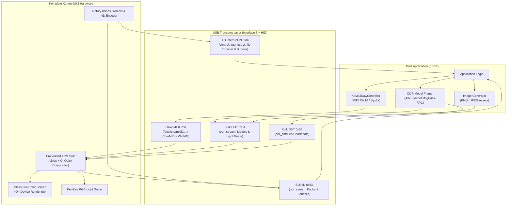

# Komplete Kontrol S-Series Mk3 Guide: DAW & On-Device Rendering (ODR)

This guide documents the full capabilities, hardware architecture, and API integration for the **Native Instruments Komplete Kontrol S-Series Mk3** (S49, S61, and S88) keyboards within [`encdr`](file:///home/rufus/Documents/Projects/Encdr/encdr/src/lib.rs).

---

## 1. Overview & Architecture

The Komplete Kontrol S-Series Mk3 introduces a fundamentally different architecture compared to previous Native Instruments controllers (such as the Maschine Mk3, Maschine Studio, or Traktor Kontrol S8/S5/D2):

- **Embedded Linux SoC**: The keyboard contains an onboard dual-core ARM System-on-Chip (SoC) executing an embedded Linux operating system and a local Qt Quick / QML rendering engine.
- **Glass Full-Color Display**: UI rendering occurs locally on the keyboard's embedded GPU.
- **Dual-Channel Host Communication**:
  1. **Direct DAW Remote Port** (`"KONTROL S-Series MK3 DAW"` / `MIDIIN2`): Standard MIDI Channel 16 Control Changes and SysEx packets for transport, mixer channels, stereo dB VU meters, 14-bit rotary knob resolution, and text readouts.
  2. **USB Bulk Interface (ODR)** (Interface 3):
     - **`odr_stream` (Bulk OUT `0x04`)**: MessagePack-RPC command pipe driving typed UI data models (parameter pages, plugin chain and Light Guide verified; browser, mixer, Smart Play and settings experimental). Each message is length-prefixed, and method names and keys are sent as indexes into a 437-symbol registry agreed in the handshake.
     - **`odr_stream` (Bulk IN `0x83`)**: Incoming event stream delivering encoder turns (`Event::Encoder` / `Event::EncoderFine`), capacitive touches (`Event::Touch`), and session handshake replies.
     - **`odr_cmd` (Bulk OUT `0x03`)**: Heartbeat keep-alive pipe (sent automatically by Encdr every 8 s after a handshake reply).
- **Physical Controls**: Anodized aluminum touch-sensitive continuous rotary encoders, 4D directional encoder, polyphonic aftertouch keybed, pitch and modulation wheels, multi-touch expression strip, and per-key Light Guide LEDs (a 64-colour palette over ODR).



---

## 2. Hardware Capabilities: What Mk3 CAN and CANNOT Do

Understanding the boundaries of the S-Series Mk3 is critical when designing your application:

### What the Mk3 CAN Do

Status: **Confirmed on hardware** = the DAW-port messages work on an S49 Mk3 from a standalone test program, but Encdr's `KkMk3DawController` output hasn't been compared against it byte for byte; **Verified** = message format confirmed on an S49 Mk3 with a standalone test program; **Experimental** = method name from the keyboard's symbol registry, payload layout provisional. Nothing below has yet been confirmed end-to-end through Encdr itself on hardware.

| Capability | Mechanism | Status | Description |
| :--- | :--- | :--- | :--- |
| **Direct DAW Remote Control** | MIDI Ch 16 + SysEx | Confirmed on hardware | Bidirectional mixer and transport control without proprietary services. |
| **High-Res 14-bit Knobs** | SysEx `0x7F` | Confirmed on hardware | Fine knob delta tracking on the DAW port. |
| **8-Track Stereo VU Meters** | SysEx `0x49` | Confirmed on hardware | Logarithmic 7-bit dB meters (`-70.0 dB` to `+6.0 dB`) for 8 channels. |
| **On-Device Parameter Pages** | ODR `set_plugin_data` | Verified | 8 knobs per page with names, formatted readouts and section headings. Every parameter is drawn as a continuous knob for now. |
| **Live Knob Input** | ODR bulk IN `0x83` | Verified | Knob turns and touches arrive as `EncoderFine` / `Encoder` / `Touch` on `encoder_1`..`encoder_8`. |
| **Real-Time Value Updates** | ODR `update_parameter_value` | Verified | Scalar updates without resending the page. |
| **Serial Plugin Chains** | ODR `set_plugin_chain` | Verified | Plugin list with names and current selection. |
| **Light Guide** | ODR `client_instance_lightguide_set` | Verified | Per-key colour by MIDI note from a 64-colour palette (`44` = unlit). |
| **Header Images (keyboard cache)** | `PluginData::background` | Verified | A numeric background selects an image already in the keyboard's cache. |
| **Uploading Header Images** | ODR `assets_add` | Experimental | PNG/JPEG upload into the keyboard's cache. |
| **Plugin Chain Selection** | ODR `set_plugin_chain_index` | Experimental | Change the focused plugin. |
| **ODR Mixer Views** | ODR `set_mixer_model` / `set_mixer_meters` | Experimental | Mixer cards with volume, pan, mute, solo, arm, and metering. |
| **Smart Play Scales & Arps** | ODR `set_smartplay` | Experimental | Scale, chord, and arpeggiator configuration. |
| **Sound & Preset Browser** | ODR `set_browser_model` | Experimental | Sound list for the on-device browser. |
| **View Page Switching** | ODR `set_page` | Parameters verified; others experimental | Switch between `Parameters`, `Browser`, `Mixer`, `SmartPlay`, `PluginChain` and `Settings`. |
| **Hardware Device Settings** | ODR `set_device_settings` | Experimental (likely wrong method) | Display / LED brightness. The current `device_setting` message is probably not the right method; `set_device_settings` / `get_device_settings` are the likely candidates. |
| **HID Buttons, Touchstrip, Button LEDs** | HID interface 2 (`control`) | Not mapped yet | The descriptor currently maps only the 4D encoder; other buttons, the touchstrip and the button LEDs still need their report layouts. |

### What the Mk3 CANNOT Do

- **No Raw 60 FPS Framebuffer Streaming Over USB**: Unlike older NI hardware (Maschine Mk3, Maschine Studio, Traktor Kontrol S8/S5/D2) which accept continuous raw RGB565 / BGR565 video framebuffers from host graphics engines (like `encdr-view`), the Mk3 does **not** expose a raw display endpoint. Its display is driven by an onboard GPU compositor running Qt Quick QML. Screen updates must be sent as typed state models or static/cached image banners.
- **No Arbitrary QML Script Upload Over USB**: The QML UI views and page layouts are pre-compiled and reside inside the keyboard's onboard Linux firmware filesystem. You cannot upload arbitrary `.qml` source files over USB to inject custom QML components.
- **No Firmware-Bypass Sleep Screen Animation**: Keyboard standby and sleep dimming are managed internally by the device firmware. You can adjust the display backlight brightness via [`DeviceSettings`](file:///home/rufus/Documents/Projects/Encdr/encdr/src/device/komplete_kontrol/odr/models.rs#L461-L477), but you cannot replace the sleep screen with an active video feed.
- **No Audio Interface Streaming**: Encdr is strictly a control surface and display driver framework. Audio input and output are handled natively by your OS audio subsystem (ALSA/PipeWire on Linux, CoreAudio on macOS, ASIO/WASAPI on Windows).

---

## 3a. Platform Notes (macOS & Windows)

The Mk3 exposes a HID control interface (buttons, encoders, LEDs), a vendor-specific bulk interface (ODR pipes, including the Light Guide) and MIDI ports (DAW remote). The OS treats them differently, and Encdr handles each interface independently, so one being unavailable does not stop the others:

| Interface | macOS | Windows |
|---|---|---|
| HID control (`control`, interface 2) | Apple's HID driver owns it; Encdr falls back to IOHIDManager automatically. May need Input Monitoring permission. | `HidUsb` owns it; Encdr falls back to the Windows HID stack automatically. |
| Bulk ODR (`odr_cmd`, `odr_stream`, interface 3) | Claimed as raw USB (confirmed on macOS). | Claimed through **WinUSB**, which NI's driver package already binds to this interface (Device Manager shows `KONTROL S49 MK3 ODR` with service `WINUSB`). Only if it shows a different driver, bind WinUSB to this interface alone (e.g. with Zadig); otherwise claiming fails with `incompatible driver` and ODR features are unavailable. |
| DFU interface | Not used by Encdr. | Bound to NI's `nikksm3dfu` driver; leave it alone. |
| DAW MIDI port | Opened by your app through CoreMIDI, not Encdr. | Opened by your app through WinMM/WinRT MIDI, not Encdr. Many Windows MIDI drivers allow only one client per port, so close NI software or other DAWs using it. |

Things to know when diagnosing:
- Run with `RUST_LOG=encdr=debug`. Look for `Opened HID interface N via hidapi` (HID fallback working), `Claimed interface N` (raw USB), and `Continuing without interface(s) [...]` (which parts are unavailable).
- On Windows, HID output reports are padded to the report length the device declares but **truncated** if longer. Encdr reads the declared lengths from the device and logs a one-time warning (`HID output report 0x..: writing N payload bytes but the device declares M`) if a write is oversized.
- `odr_cmd`/`odr_stream` writes run on their own thread, so a slow bulk upload (such as the header PNG) never delays button or encoder events.
- `odr_stream` (bulk OUT 0x04) carries all MessagePack-RPC commands and the Light Guide; `odr_cmd` (bulk OUT 0x03) carries the 8-second heartbeat.
- If NI's background services (`NIHardwareAgent`, `NIHostIntegrationAgent`, NI Hardware Connection Service) or the Komplete Kontrol software are running, they hold interface 3 and the keyboard's session. Quit them before running Encdr ODR apps: on Windows stop the services in `services.msc`; on macOS quit the apps and run `killall NIHardwareAgent NIHostIntegrationAgent`.
- Interface claiming has been confirmed on Windows 11 and macOS with an S49 Mk3 (`17cc:2100`): HID through the OS fallback, interface 3 as raw USB. The S61 and S88 Mk3 are assumed to share the S49's layout.

---

## 3. Connecting to the Keyboard

The Komplete Kontrol Mk3 requires two communication handles:
1. **USB (Encdr)**: Encdr opens HID interface 2 (`control`) for buttons and the 4D encoder, and claims interface 3 for ODR: commands on `odr_stream` (bulk OUT `0x04`), knob events and replies on bulk IN `0x83`, and the heartbeat on `odr_cmd` (bulk OUT `0x03`).
2. **DAW Remote MIDI Port**: Opens the dedicated MIDI port (`"KONTROL S-Series MK3 DAW"`) for Channel 16 CCs and SysEx.

```rust
use encdr::{Encdr, EncdrConfig, DeviceId, KkMk3DawController};

let mut encdr = Encdr::new(EncdrConfig::default())?;
let devices = encdr.scan()?;

// Find the connected Komplete Kontrol Mk3 device
let mk3_id = devices.into_iter().find(|id| {
    if let Some(desc) = encdr.device_descriptor(*id) {
        desc.name.contains("Komplete Kontrol S") && desc.name.contains("Mk3")
    } else {
        false
    }
}).expect("No Komplete Kontrol Mk3 keyboard detected");

println!("Connected to Mk3 on USB: {:?}", mk3_id);

// Initialize DAW Remote controller
let daw = KkMk3DawController::new();
```

---

## 4. DAW Remote Control Guide (MIDI CC & SysEx)

The DAW Remote port operates on **MIDI Channel 16** (Status byte `0xBF`) and uses universal SysEx manufacturer header `F0 00 21 09 00 00 44 43 01 00 ... F7`.

### 4.1 Handshake & Session Initialization

On application startup, send the handshake sequence to switch the keyboard into DAW integration mode and enable high-resolution 14-bit rotary knob tracking:

```rust
// 1. Hello handshake (DAW protocol v4)
let hello = daw.build_hello(); // [0xBF, 0x01, 0x04]
// Send `hello` to the DAW MIDI OUT port...

// 2. Enable 14-bit high-resolution SysEx rotary knob updates
let enable_14bit = daw.build_enable_14bit(); // [0xBF, 0x06, 0x01]
// Send `enable_14bit` to the DAW MIDI OUT port...

// 3. Register your host application name
let identity = daw.build_identity("My DAW Host", 1, 0);
// Send `identity` to the DAW MIDI OUT port...

// 4. Set vertical track orientation
let config = daw.build_surface_configuration_vertical();
// Send `config` to the DAW MIDI OUT port...
```

On exit, send the goodbye message to restore standalone state:

```rust
let goodbye = daw.build_goodbye(); // [0xBF, 0x02, 0x00]
// Send `goodbye` to the DAW MIDI OUT port...
```

### 4.2 Configuring Track Strips & VU Meters

Configure track names, selection states, solo/mute/arm status, colors, and live stereo VU meters across the 8 channel strips:

```rust
// Set track names
let name_msg = daw.build_track_name(0, "Lead Synth");
let color_msg = daw.build_track_color_rgba(0, 0.0, 0.8, 1.0, 1.0); // Cyan #FF00CCFF
let selected_msg = daw.build_track_selected(0, true);
let armed_msg = daw.build_track_armed(0, true);

// Formatted volume and pan readouts
let vol_msg = daw.build_volume_display(0, "-3.5 dB");
let pan_msg = daw.build_pan_display(0, "L 15");

// 8-channel stereo VU meters (-70.0 dB to +6.0 dB, f32::NEG_INFINITY for silence)
let left_levels = [-6.0, -12.0, -18.0, -24.0, f32::NEG_INFINITY, -3.0, -9.0, -15.0];
let right_levels = [-6.0, -12.0, -18.0, -24.0, f32::NEG_INFINITY, -3.0, -9.0, -15.0];
let vu_msg = daw.build_vu_meters(&left_levels, &right_levels);
```

### 4.3 Parsing Incoming DAW Remote Events

Incoming MIDI packets from Channel 16 are parsed via [`KkMk3DawController::parse_incoming`](file:///home/rufus/Documents/Projects/Encdr/encdr/src/device/komplete_kontrol/daw.rs#L302-L350):

```rust
use encdr::{KkMk3DawController, KkMk3DawEvent};

let incoming_midi_bytes: &[u8] = /* received from MIDI IN */;

if let Some(event) = daw.parse_incoming(incoming_midi_bytes) {
    match event {
        KkMk3DawEvent::Button { name, pressed, .. } => {
            println!("DAW Button: {} (pressed: {})", name, pressed);
        }
        KkMk3DawEvent::Navigation { name, delta, .. } => {
            println!("Navigation {}: relative delta {}", name, delta);
        }
        KkMk3DawEvent::KnobAdjustment14Bit { group, index, delta } => {
            println!("14-bit Knob [{:?}] slot #{}: delta {:+.4}", group, index, delta);
        }
        KkMk3DawEvent::BankMapping(mode) => {
            println!("Bank mapping switched: {:?}", mode);
        }
        KkMk3DawEvent::SelectedTrackVolumeDelta(delta) => {
            println!("Volume fine delta: {}", delta);
        }
        KkMk3DawEvent::SelectedTrackPanDelta(delta) => {
            println!("Pan fine delta: {}", delta);
        }
        KkMk3DawEvent::PluginSelected { chain_index } => {
            println!("Plugin slot focused: #{}", chain_index);
        }
        KkMk3DawEvent::TempoChangeBpm(bpm) => {
            println!("Hardware requested BPM change: {:.1}", bpm);
        }
        KkMk3DawEvent::OtherSysEx(_) => {}
    }
}
```

---

## 5. On-Device Rendering (ODR) Guide

ODR communication uses MessagePack-RPC envelopes transmitted over USB Interface 3. High-level helper methods on [`Encdr`](file:///home/rufus/Documents/Projects/Encdr/encdr/src/lib.rs#L44-L50) format, frame (4-byte little-endian length prefix), index symbols through the 437-entry registry, and dispatch packets automatically over `odr_stream` (Bulk OUT `0x04`) and `odr_cmd` (Bulk OUT `0x03`).

### 5.0 Session Handshake & Lifecycle Initialization

Before parameter pages can be displayed, the keyboard needs a session: a handshake (protocol version `2.5.0` plus the 437-symbol registry), then instance registration. The flow is event-driven:

1. **Handshake** — [`kk_mk3_handshake`](../encdr/src/lib.rs) sends it on `odr_stream`.
2. **Reply** — the keyboard answers with `Event::KkMk3Odr { event: KkMk3OdrEvent::HandshakeReply, .. }`. Encdr's device thread then sends the heartbeat on `odr_cmd` (0x03) every 8 s by itself.
3. **Session + pages** — on that reply, call [`kk_mk3_start_session`](../encdr/src/lib.rs) (`client_instance_add` → `client_page_set` → `client_focus_acquire` → `client_instance_set_host_owned_instance_client_state`) and send your pages.
4. **Re-handshake** — if the keyboard sends `agent_heartbeat_request_handshake`, Encdr re-handshakes automatically. The next `HandshakeReply` means the keyboard has forgotten everything, so step 3 runs again. Handling every `HandshakeReply` the same way covers both cases.

```rust
encdr.kk_mk3_handshake(mk3_id)?;

for event in encdr.events().iter() {
    match event {
        Event::KkMk3Odr { event: KkMk3OdrEvent::HandshakeReply, .. } => {
            encdr.kk_mk3_start_session(mk3_id, "Komplete Kontrol", "Encdr Synth")?;
            encdr.kk_mk3_set_plugin_data(mk3_id, &plugin)?;
        }
        Event::EncoderFine { name, delta, .. } => { /* encoder_1..encoder_8 */ }
        _ => {}
    }
}
```

Incoming messages on bulk IN `0x83` are reassembled across USB transfers, so long messages (such as the settings the keyboard sends after the handshake reply) arrive intact.

> **Verified vs experimental:** the handshake, session setup, parameter page, parameter value updates, plugin chain and Light Guide messages are verified on an S49 Mk3. Mixer, meters, SmartPlay, browser, device settings, plugin-chain index, asset upload / header image and non-parameter pages are not verified yet; their payloads are provisional and the keyboard may ignore them.

### 5.1 Designing Parameter Pages

Build an 8-knob parameter page using [`PluginData`](file:///home/rufus/Documents/Projects/Encdr/encdr/src/device/komplete_kontrol/odr/models.rs#L130-L172) and [`ParameterItem`](file:///home/rufus/Documents/Projects/Encdr/encdr/src/device/komplete_kontrol/odr/models.rs#L78-L125).

#### Available Widget Display Types

> `display_type` is stored on each `ParameterItem` but **not sent yet**: every parameter is currently drawn as a continuous knob, the only style verified so far. The table describes the intended mapping.

| Widget Type | Enum Variant | Visual Appearance |
| :--- | :--- | :--- |
| **Knob** | [`WidgetDisplayType::Knob`](file:///home/rufus/Documents/Projects/Encdr/encdr/src/device/komplete_kontrol/odr/models.rs#L60) | Radial circular arc gauge. |
| **Range** | [`WidgetDisplayType::Range`](file:///home/rufus/Documents/Projects/Encdr/encdr/src/device/komplete_kontrol/odr/models.rs#L62) | Linear continuous slider bar. |
| **Toggle** | [`WidgetDisplayType::Toggle`](file:///home/rufus/Documents/Projects/Encdr/encdr/src/device/komplete_kontrol/odr/models.rs#L64) | 2-state On/Off switch button. |
| **Trigger** | [`WidgetDisplayType::Trigger`](file:///home/rufus/Documents/Projects/Encdr/encdr/src/device/komplete_kontrol/odr/models.rs#L66) | Momentary action / strike button. |
| **Increment** | [`WidgetDisplayType::Increment`](file:///home/rufus/Documents/Projects/Encdr/encdr/src/device/komplete_kontrol/odr/models.rs#L68) | Discrete stepped selector (e.g. shapes, octaves). |
| **Relative** | [`WidgetDisplayType::Relative`](file:///home/rufus/Documents/Projects/Encdr/encdr/src/device/komplete_kontrol/odr/models.rs#L70) | Bipolar center-detented indicator (`-1.0` to `+1.0`). |
| **Text** | [`WidgetDisplayType::Text`](file:///home/rufus/Documents/Projects/Encdr/encdr/src/device/komplete_kontrol/odr/models.rs#L72) | Static text label readout. |
| **Disabled** | [`WidgetDisplayType::Disabled`](file:///home/rufus/Documents/Projects/Encdr/encdr/src/device/komplete_kontrol/odr/models.rs#L74) | Empty knob slot. |

#### Building and Sending a Page

```rust
use encdr::{ParameterItem, PluginData, RgbColor, WidgetDisplayType};

let mut plugin = PluginData::new("Analog Monolith", RgbColor::CYAN);

// Add up to 8 parameters mapped to the physical encoders
plugin.add_parameter(ParameterItem::knob("Cutoff", 0.72, "3.4 kHz", "Filter"));
plugin.add_parameter(ParameterItem::knob("Resonance", 0.45, "45%", "Filter"));
plugin.add_parameter(ParameterItem::knob("Drive", 0.20, "+3.0 dB", "Filter"));
plugin.add_parameter(ParameterItem::toggle("Lowpass 24", true, "Filter"));

plugin.add_parameter(ParameterItem::knob("Attack", 0.15, "12 ms", "Envelope"));
plugin.add_parameter(ParameterItem::knob("Decay", 0.50, "320 ms", "Envelope"));
plugin.add_parameter(ParameterItem::knob("Sustain", 0.80, "-2.0 dB", "Envelope"));
plugin.add_parameter(ParameterItem::knob("Release", 0.35, "180 ms", "Envelope"));

// Dispatch parameter model and layout sections to the keyboard
encdr.kk_mk3_set_plugin_data(mk3_id, &plugin)?;
```

### 5.2 Real-Time Parameter Value Updates & Live Encoder Feedback

When a knob is turned, the keyboard sends `plugin_action` messages on Bulk IN `0x83`. Encdr's device thread reassembles them and emits `Event::EncoderFine` (the raw fractional delta, e.g. `+0.012`), `Event::Encoder` (`±1`) and `Event::Touch`, named `encoder_1`..`encoder_8`. The host owns parameter values: add the delta to your value and send the result back, as below. Absolute values set from the keyboard arrive as `Event::KkMk3Odr { event: KkMk3OdrEvent::ParameterSet { .. }, .. }`.

You can update the parameter's displayed value and gauge on screen without re-transmitting the entire model tree:

```rust
// Update Cutoff (knob index 0, 0-based) with a scalar
encdr.kk_mk3_update_parameter_value(mk3_id, 0, 0.85)?;

// Or provide a formatted display string:
encdr.kk_mk3_update_parameter_value_with_display(mk3_id, 0, 0.85, "4.2 kHz")?;
```

---

## 6. Graphical Header Banners & Image Generation

The top area of the Mk3's glass display renders a full-width header banner. You can display pre-rendered PNG/JPEG images or generate custom graphics on the host.

> **Experimental.** Uploading images (`kk_mk3_register_asset`, `kk_mk3_set_header_image`) is not yet verified. What is verified is selecting an image the keyboard already has cached, by setting a numeric background, e.g. `PluginData::new(..).with_background("21")`.

### 6.1 Registering and Displaying an Image Asset

Image assets are registered into the keyboard's onboard cache under an arbitrary asset ID string:

```rust
// Read a pre-rendered PNG banner from disk
let banner_png = std::fs::read("assets/synth_banner.png")?;

// 1. Register the asset in cache
encdr.kk_mk3_register_asset(mk3_id, "my_synth_banner", &banner_png)?;

// 2. Attach the asset ID to the plugin model
plugin.background = Some("my_synth_banner".to_string());
encdr.kk_mk3_set_plugin_data(mk3_id, &plugin)?;
```

Or use the convenience helper [`kk_mk3_set_header_image`](file:///home/rufus/Documents/Projects/Encdr/encdr/src/lib.rs#L515-L525) to perform both operations in one call:

```rust
encdr.kk_mk3_set_header_image(mk3_id, "my_synth_banner", &banner_png, &mut plugin)?;
```

### 6.2 Host-Side Dynamic Image Generation

You can dynamically render banners on the host (e.g. using the `image` crate, a software rasterizer, or canvas renderer) and encode them to PNG in memory before uploading:

```rust
fn create_dynamic_banner(title: &str, accent_color: [u8; 3]) -> Vec<u8> {
    let width = 1200u32;
    let height = 240u32;
    let mut img = image::RgbImage::new(width, height);

    // Draw background gradient
    for (x, y, pixel) in img.enumerate_pixels_mut() {
        let t = x as f32 / width as f32;
        let r = (20.0 * (1.0 - t) + accent_color[0] as f32 * t * 0.4) as u8;
        let g = (20.0 * (1.0 - t) + accent_color[1] as f32 * t * 0.4) as u8;
        let b = (30.0 * (1.0 - t) + accent_color[2] as f32 * t * 0.4) as u8;
        *pixel = image::Rgb([r, g, b]);
    }

    // Encode to PNG bytes in memory
    let mut png_bytes = Vec::new();
    let encoder = image::codecs::png::PngEncoder::new(&mut png_bytes);
    image::ImageEncoder::write_image(
        encoder,
        img.as_raw(),
        width,
        height,
        image::ColorType::Rgb8.into(),
    ).expect("PNG encode failed");

    png_bytes
}

// Upload dynamic banner to the keyboard
let dynamic_png = create_dynamic_banner("Encdr Modular", [0, 210, 255]);
encdr.kk_mk3_set_header_image(mk3_id, "live_modular_banner", &dynamic_png, &mut plugin)?;
```

### 6.3 Dynamic HTML/CSS/Canvas Rendering via `encdr-view`

You can use the [`encdr-view`](file:///home/rufus/Documents/Projects/Encdr/encdr-view/src/lib.rs) crate to design and render dynamic graphical banners using web standards (HTML, CSS, SVG, Canvas 2D, or WebGL). 

`ScreenView::new_offscreen` creates a headless WebView sized precisely to the header banner area ($1200\times 240$). You can send runtime telemetry from Rust to JavaScript via `view.send()`, let HTML/Canvas composite the graphics, capture the frame as a PNG with `view.capture_png()`, and push it directly into the Mk3's on-device banner cache:

```rust
use encdr_view::{ScreenContent, ScreenView};

// 1. Define an HTML banner template with a live Canvas visualizer
let html_banner = r#"
<!DOCTYPE html>
<html>
<head>
<style>
  body { margin: 0; background: #0a0e14; overflow: hidden; font-family: sans-serif; color: #fff; }
  .header { display: flex; justify-content: space-between; align-items: center; padding: 20px 40px; }
  .title { font-size: 38px; font-weight: bold; color: #00d2ff; }
  .badge { background: #1f2b38; padding: 6px 14px; border-radius: 6px; font-size: 20px; }
  canvas { position: absolute; bottom: 0; left: 0; width: 1200px; height: 100px; }
</style>
</head>
<body>
  <div class="header">
    <div class="title">WAVETABLE MONOLITH</div>
    <div class="badge" id="preset">Patch A-01: Cyber Lead</div>
  </div>
  <canvas id="scope" width="1200" height="100"></canvas>
  <script>
    const canvas = document.getElementById('scope');
    const ctx = canvas.getContext('2d');
    let phase = 0;

    window.encdr = {
      onMessage: function(channel, data) {
        if (channel === 'preset_name') {
          document.getElementById('preset').innerText = data.name;
        }
      }
    };

    function draw() {
      ctx.clearRect(0, 0, canvas.width, canvas.height);
      ctx.strokeStyle = '#00d2ff';
      ctx.lineWidth = 4;
      ctx.beginPath();
      for (let x = 0; x < canvas.width; x += 10) {
        const y = 50 + Math.sin(x * 0.02 + phase) * 35;
        if (x === 0) ctx.moveTo(x, y); else ctx.lineTo(x, y);
      }
      ctx.stroke();
      phase += 0.05;
      window.ipc && window.ipc.postMessage('__encdr_frame_ready');
    }
    setInterval(draw, 100); // 10 FPS banner refresh
  </script>
</body>
</html>
"#;

// 2. Instantiate an offscreen WebView sized to 1200x240
let mut banner_view = ScreenView::new_offscreen(
    1200,
    240,
    ScreenContent::Html(html_banner.to_string()),
    false, // headless (set to true to debug in a preview window)
)?;

// 3. In your application tick loop:
ScreenView::pump_events();

// Push state updates into the web UI
banner_view.send("preset_name", serde_json::json!({ "name": "Patch B-04: Neon Bass" }));

// If the WebView has composited a new frame, capture PNG and upload to Mk3
if banner_view.is_frame_ready() {
    let png_bytes = banner_view.capture_png()?;
    encdr.kk_mk3_set_header_image(mk3_id, "live_webview_banner", &png_bytes, &mut plugin)?;
}
```

---

## 7. Extended ODR Models

> Only `kk_mk3_set_plugin_chain` (7.1) and `KkMk3Page::Parameters` (7.6) are verified. Everything else in this section is **experimental**: the method names are from the keyboard's symbol registry, but the payload layouts are provisional and the keyboard may ignore them until they are verified on hardware.

### 7.1 Serial Plugin Chain

Display the track's serial insert chain (instruments and audio effects):

```rust
use encdr::{PluginChainModel, PluginChainItem, RgbColor};

let mut chain = PluginChainModel::new();
chain.add_plugin(PluginChainItem::new("Analog Monolith", RgbColor::CYAN).with_vendor("Encdr Audio"));
chain.add_plugin(PluginChainItem::new("Stereo Delay", RgbColor::GREEN).with_vendor("Encdr Audio"));
chain.add_plugin(PluginChainItem::new("Raum Reverb", RgbColor::BLUE).with_vendor("Native Instruments"));
chain.set_current_index(0); // Select first plugin

encdr.kk_mk3_set_plugin_chain(mk3_id, &chain)?;

// Change focused plugin index (experimental)
encdr.kk_mk3_set_plugin_chain_index(mk3_id, 1)?;
```

### 7.2 ODR Mixer Model & Stereo VU Meters

Populate the onscreen multi-channel mixer:

```rust
use encdr::{MixerModel, MixerTrack, RgbColor};

let mut mixer = MixerModel::new();
let mut track1 = MixerTrack::new("Lead Synth", RgbColor::CYAN);
track1.volume = 0.85;
track1.volume_display = "-1.5 dB".into();
track1.pan = -0.2;
track1.pan_display = "L 20".into();

let track2 = MixerTrack::new("Drums", RgbColor::ORANGE);
mixer.add_track(track1);
mixer.add_track(track2);

encdr.kk_mk3_set_mixer_model(mk3_id, &mixer)?;

// Stream stereo VU meters (0.0 .. 1.0)
let left_meters = [0.75, 0.50];
let right_meters = [0.72, 0.48];
encdr.kk_mk3_set_mixer_meters(mk3_id, &left_meters, &right_meters)?;
```

### 7.3 Smart Play (Scales, Chords & Arpeggiator)

Configure the onboard Smart Play engine:

```rust
use encdr::SmartPlayData;

let mut smartplay = SmartPlayData::default();
smartplay.scale.enabled = true;
smartplay.scale.root_key = 2; // D
smartplay.scale.scale_type = "Dorian".into();

smartplay.arp.enabled = true;
smartplay.arp.pattern = "UpDown".into();
smartplay.arp.rate = "1/16".into();

smartplay.chord.enabled = true;
smartplay.chord.chord_type = "Octave".into();

encdr.kk_mk3_set_smartplay(mk3_id, &smartplay)?;
```

### 7.4 Sound & Preset Browser

Populate category filter tags and preset sound items in the browser view:

```rust
use encdr::{BrowserModel, BrowserFilter, BrowserSoundItem};

let mut browser = BrowserModel::default();

// Add category filter columns
browser.filters.push(
    BrowserFilter::new("Category", vec!["Synths".into(), "Bass".into(), "Pads".into()])
        .with_selection("Synths")
);
browser.filters.push(
    BrowserFilter::new("Sub-Category", vec!["Lead".into(), "Pluck".into(), "Sequence".into()])
        .with_selection("Lead")
);

// Add preset items
browser.sounds.push(BrowserSoundItem::new("Blade Runner Lead", "Encdr", "Analog Monolith"));
browser.sounds.push(BrowserSoundItem::new("Sub Zero Bass", "Encdr", "Analog Monolith"));
browser.selected_sound_index = Some(0);

encdr.kk_mk3_set_browser_model(mk3_id, &browser)?;
```

### 7.5 Hardware Device Settings

Adjust display backlight brightness and button LED brightness. **Experimental and probably wrong:** the `device_setting` message Encdr currently sends is likely not the right method (`set_device_settings` / `get_device_settings` are the likely candidates). `velocity_curve` and `lightguide_enabled` are not sent at all.

```rust
use encdr::DeviceSettings;

let mut settings = DeviceSettings::default();
settings.display_brightness = 90; // 0..100%
settings.led_brightness = 75;     // 0..100%
settings.velocity_curve = "Soft".into();

encdr.kk_mk3_set_device_settings(mk3_id, &settings)?;
```

### 7.6 Switching Screen Views

Switch the active view template on the keyboard display using [`kk_mk3_set_page`](file:///home/rufus/Documents/Projects/Encdr/encdr/src/lib.rs#L613-L623):

```rust
use encdr::KkMk3Page;

// Show parameter controls
encdr.kk_mk3_set_page(mk3_id, KkMk3Page::Parameters)?;

// Show preset browser
encdr.kk_mk3_set_page(mk3_id, KkMk3Page::Browser)?;

// Show mixer view
encdr.kk_mk3_set_page(mk3_id, KkMk3Page::Mixer)?;

// Show Smart Play view
encdr.kk_mk3_set_page(mk3_id, KkMk3Page::SmartPlay)?;

// Show device settings
encdr.kk_mk3_set_page(mk3_id, KkMk3Page::Settings)?;
```

---

## 8. Keybed Light Guide

The Light Guide is addressed by MIDI note, with a colour index `0..=63` from the keyboard's palette (`44` is unlit). The first key is note 36 on the S49/S61 and note 21 on the S88. 2 updates per second is verified; the demo uses 10, and the keyboard's throughput limit is unknown.

The per-key Light Guide LEDs can be driven either via RGB color tuples with [`kk_mk3_set_lightguide`](file:///home/rufus/Documents/Projects/Encdr/encdr/src/lib.rs) (which Encdr converts to the nearest Mk3 palette colors) or directly by MIDI note and palette color index with [`kk_mk3_set_lightguide_indexed`](file:///home/rufus/Documents/Projects/Encdr/encdr/src/lib.rs):

```rust
// Animate a rainbow sweep across 61 keys
let key_count = 61;
let mut keys = Vec::with_capacity(key_count);

let phase = 0.5f32; // animation phase
for i in 0..key_count {
    let hue = (i as f32 / key_count as f32 + phase) % 1.0;
    let (r, g, b) = hsv_to_rgb(hue, 1.0, 0.8);
    keys.push((r, g, b));
}

// Drive via RGB
encdr.kk_mk3_set_lightguide(mk3_id, &keys)?;

// Or drive specific MIDI notes directly by color index (0..63, 44 = idle/off):
let indexed = vec![(36u8, 12u8), (48u8, 24u8), (60u8, 36u8)];
encdr.kk_mk3_set_lightguide_indexed(mk3_id, &indexed)?;
```

---

## 9. Complete Working Example

See [`examples/komplete_kontrol/kk_mk3_daw_odr.rs`](file:///home/rufus/Documents/Projects/Encdr/examples/komplete_kontrol/kk_mk3_daw_odr.rs) for the complete reference application demonstrating:
- DAW remote greeting, 14-bit SysEx mode enable, track labeling, and VU meters (built and printed; the app sends these over the DAW MIDI port).
- Event-driven ODR session: handshake, waiting for `HandshakeReply`, and resending the session and page on every reply (heartbeat and re-handshake are handled by Encdr).
- On-device parameter page with 8 knobs and section layout, updated live from knob turns (`Event::EncoderFine`).
- Light Guide colour sweep at 10 FPS.
- Plugin chain, browser, mixer, SmartPlay and settings models are built but **not sent**, since those messages aren't verified yet.

Run the example with:
```bash
cargo run -p encdr-examples --bin kk_mk3_daw_odr
```
